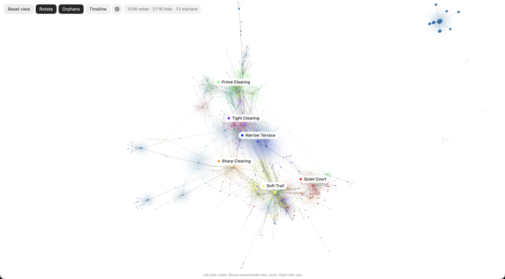

<p align="center">
  
</p>

# Galaxy Graph

An Obsidian plugin that renders your whole vault as a navigable 3D force-directed graph.
Every note is a point, every link is a line, and every well-connected note gathers its
neighbourhood under a soft cloud of its own colour. Orbit, zoom, click a note to inspect
it, and replay your vault's history as a timeline.

## Demo

**Exploring a vault**: orbiting, clicking a neighbourhood, inspecting a note:


**Vault timeline**: notes appear in the order they were created and settle into place:


The canvas takes its colours from your Obsidian theme, light or dark:



## Requirements

- Obsidian 1.7.2 or later, desktop only
- Node 22 and npm, only if you build from source

## Installation

In Obsidian, open Settings → Community plugins → Browse, search for **Galaxy Graph**, then
install and enable it. The listing is at
[community.obsidian.md/plugins/galaxy-graph](https://community.obsidian.md/plugins/galaxy-graph).

To install by hand instead, download `main.js`, `manifest.json` and `styles.css` from the
[latest release](https://github.com/ZachFara/galaxy-graph/releases/latest) into
`<YourVault>/.obsidian/plugins/galaxy-graph/` and enable the plugin. To build from source:

```bash
git clone https://github.com/ZachFara/galaxy-graph.git
cd galaxy-graph
npm ci
npm run build
```

## Usage

Open the galaxy from the ribbon icon or the command **Open galaxy view**.

- **Orbit**: left-drag. **Pan**: right-drag. **Zoom**: scroll wheel or pinch.
- **Click a note**: selects it, highlights its links and opens the inspector. The camera stays put.
- **Double-click a note, or click a label**: flies the camera to that note's neighbourhood.
- **Reset view** (or Escape): frames the whole galaxy again and clears the selection.
- **Click the background**: clears the selection without moving.
- **Rotate**, **Orphans** and **Timeline** are toggles in the top bar; the gear opens the settings rail.

## Inspector


For the selected note: incoming, outgoing and total links, its folder, the first lines of
its body, an **Open note** button, and **Add note here**, which creates a new note in the
same folder linked back to this one. Below that, the notes it links to and is linked from,
a chart of how its cluster grew over time, and its local neighbourhood as a mini-graph or
a list when there are many neighbours.

## Settings

The settings rail covers colour mapping (by folder, by tag with per-tag colours, index
versus normal, or recent activity), the popularity time dimension used by the growth chart,
link opacities, neighbourhood clouds (on or off, colour or heat, opacity), the template for
notes created from the inspector, physics, labels and rotation speed. Notes matching
Obsidian's _Files and links → Excluded files_ setting are left out, as in the core graph.

## Performance

The plugin warns above 2 000 notes. It still renders; it may be slower on older hardware.
All graph state is in memory and nothing is written to disk except the plugin's own
settings.

## Contributing

Development conventions, the single check command and the architecture are in
[AGENTS.md](AGENTS.md); the design is in [DESIGN.md](DESIGN.md); open tasks are in
[PROGRESS.md](PROGRESS.md).

## Credits

The logo was generated with ChatGPT's image generation feature.
