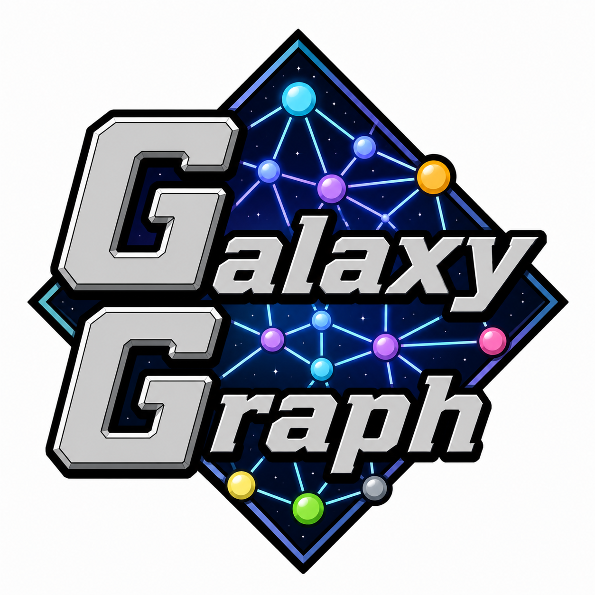
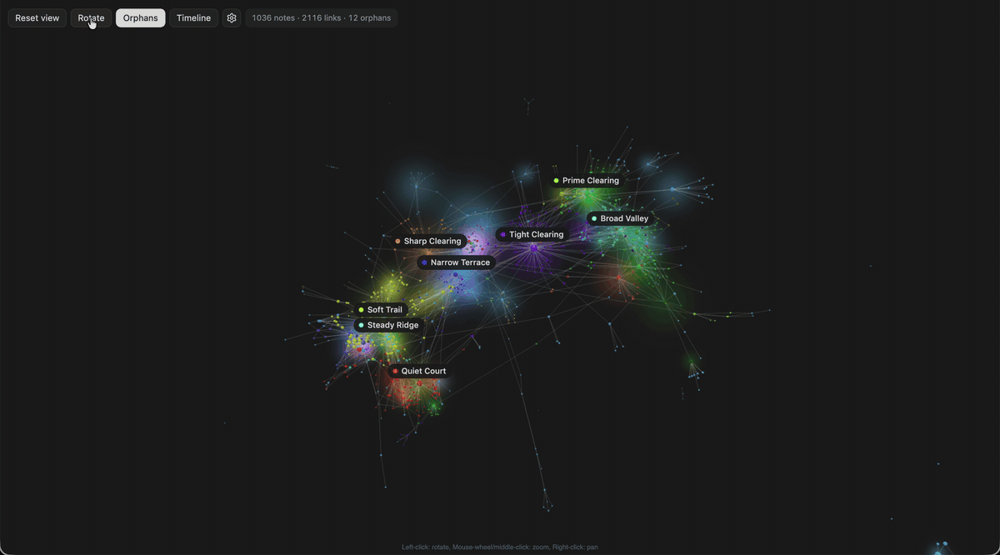
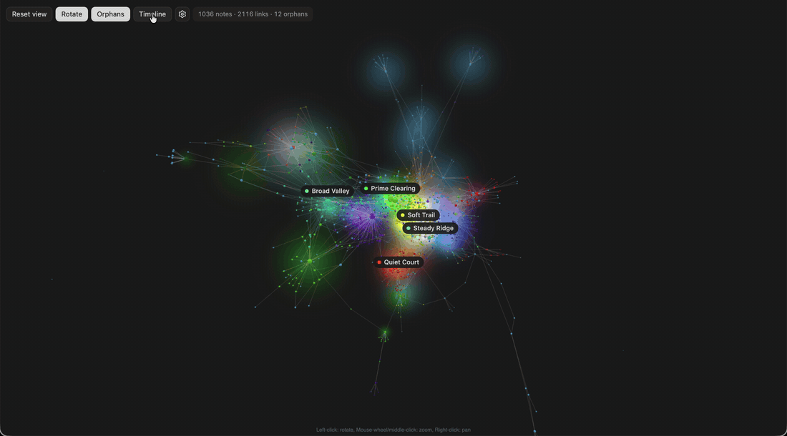
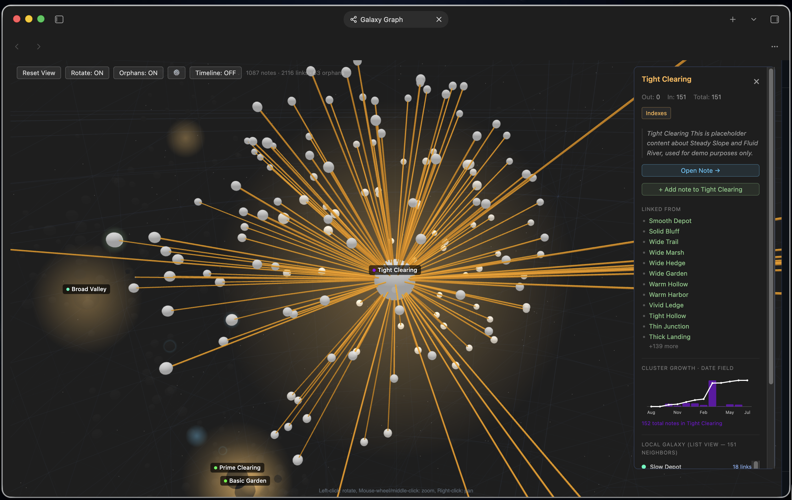

<p align="center">
  
</p>

# Galaxy Graph

An Obsidian plugin that renders your entire vault as a navigable 3D force-directed
graph. Explore your second brain like a galaxy — orbit, zoom, pan, click nodes to
inspect them, and double-click to fly the camera toward any note.

## Demo

**Exploring a vault** — orbiting, clicking nodes, inspecting connections:



**Vault Timeline** — replaying your vault's history, notes appearing in the order
they were created:



## Requirements

- Obsidian 1.4 or later (desktop only)
- Node 18+ and npm (for building)

## Installation

Manual install (not yet on the Community Plugins store):

1. Clone this repo somewhere outside your vault, then build it:
   ```bash
   git clone https://github.com/<your-fork>/galaxy-graph.git
   cd galaxy-graph
   npm install
   npm run build
   ```
2. Copy `main.js`, `manifest.json`, and `styles.css` into a new folder in your
   vault:
   ```bash
   mkdir -p "<YourVault>/.obsidian/plugins/galaxy-graph"
   cp main.js manifest.json styles.css "<YourVault>/.obsidian/plugins/galaxy-graph/"
   ```
3. In Obsidian: Settings → Community Plugins → toggle **Galaxy Graph** on.

## Developing

```bash
npm run dev   # watches main.ts/src and rebuilds main.js on every save
```

After each rebuild, copy `main.js` into your vault's plugin folder again and
reload it: Settings → Community Plugins → disable **Galaxy Graph** → re-enable
it (or reload the whole app with `Cmd+R`).

To skip the manual copy step during development, symlink the build output
straight into your vault instead of copying it:

```bash
ln -sf "$(pwd)/main.js" "<YourVault>/.obsidian/plugins/galaxy-graph/main.js"
```

## Usage

- Click the **network icon** in the left ribbon, or run the command
  **Open Galaxy Graph** via the command palette (Cmd/Ctrl+P).
- **Orbit**: left-drag
- **Pan**: right-drag (or two-finger drag on trackpad)
- **Zoom**: scroll wheel / pinch
- **Single-click a node**: highlights its direct connections and opens the
  inspector panel on the right
- **Double-click a node**: camera flies toward it
- **Reset View** button: returns to full-galaxy view and clears highlights
- **Background click**: clears the current selection

## Inspector panel

Shows for the selected note:
- Title (coloured by folder)
- Out / In / Total connection counts
- First ~200 chars of note body (frontmatter stripped)
- "Open Note →" button — opens the file in a new tab
- "Links to" list — notes this note wikilinks to (clickable, navigates selection)
- "Linked from" list — notes that wikilink to this note

Clicking a hub note also shows its cluster growth over time and a scrollable
local neighborhood list:



Node size scales with total connections (degree). Hub notes are larger and
visually brighter when highlighted, and color can be mapped by folder, tag,
index status, or note activity depending on your settings.

## Performance note

The plugin warns if your vault exceeds 2 000 notes. It still renders — it just
may be slower on older hardware. All graph state is in memory; nothing is written
to disk.

## Credits

The logo at the top of this README was generated with ChatGPT's image generation feature.
